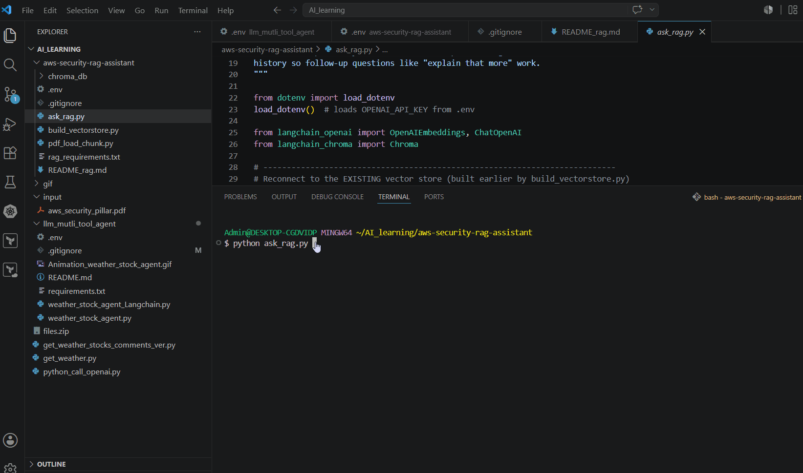

# AWS Security RAG Assistant

A Retrieval-Augmented Generation (RAG) assistant that answers questions about AWS security best practices, grounded in the official **AWS Well-Architected Framework — Security Pillar** whitepaper. Ask a question in plain English from the terminal and get an answer generated from the actual document content — not the model's general training knowledge.

Built as a hands-on learning project to understand the full RAG pipeline (load → chunk → embed → store → retrieve → generate) before relying on higher-level abstractions.

## What it does

```
AWS Security RAG Assistant — ask a question, or type 'exit' to quit.

You: What are best practices for IAM permissions?

Assistant: [Answer synthesized from the actual whitepaper content, e.g.
covering least privilege, IAM Identity Center permission sets, and
IAM Access Analyzer policy generation.]

You: exit
Goodbye!
```

## How it works

1. **Load** — the AWS Security Pillar PDF (240 pages) is loaded and its text extracted
2. **Chunk** — split into ~1000-character overlapping chunks, so retrieval can find focused, specific passages rather than entire pages
3. **Embed** — each chunk is converted into a vector (numeric representation of meaning) using OpenAI's `text-embedding-3-small` model
4. **Store** — vectors are saved locally in a Chroma vector database (`./chroma_db`), so embedding only needs to happen once
5. **Retrieve** — when you ask a question, it's embedded too, and the 3 most semantically similar chunks are pulled from the database
6. **Generate** — those chunks are handed to the LLM as context, with an explicit instruction to answer *only* from that context (and say "I don't know" if it isn't covered) — this reduces hallucination compared to a plain chat prompt

## Project structure

```
aws-security-rag-assistant/
├── build_vectorstore.py   # one-time setup: load PDF, chunk, embed, save to disk
├── ask_rag.py             # interactive terminal Q&A against the saved vector store
├── requirements.txt
├── .env
├── .gitignore
```

## Setup

1. Clone the repo:
   ```bash
   git clone https://github.com/<your-username>/aws-security-rag-assistant.git
   cd aws-security-rag-assistant
   ```

2. Install dependencies:
   ```bash
   pip install -r requirements.txt
   ```

3. Copy `.env.example` to `.env` and add your OpenAI key:
   ```bash
   cp .env.example .env
   ```

4. Download the AWS Well-Architected Security Pillar whitepaper PDF from:
   https://docs.aws.amazon.com/wellarchitected/latest/security-pillar/welcome.html
   Save it in the project folder as `aws_security_pillar.pdf`.

5. Build the vector store (one-time step — takes a few minutes due to rate-limit-safe batching):
   ```bash
   python build_vectorstore.py
   ```

6. Ask questions:
   ```bash
   python ask_rag.py
   ```

## Design notes / things I learned

- **Batching embedding requests is necessary, not optional** — sending all ~665 chunks in a single call exceeded OpenAI's tokens-per-minute limit (429 rate-limit error) on a standard account tier. Splitting into batches of 50 with a short delay between calls resolved it.
- **Separating "build" from "ask"** — the vector store only needs to be built once; re-running the whole embed pipeline on every question wastes time and API cost. `build_vectorstore.py` and `ask_rag.py` are deliberately separate scripts for this reason.
- **Prompting matters even in RAG** — without explicitly instructing the model to answer "using only the context below" and to say "I don't know" when the context doesn't cover the question, it can blend in outside knowledge or guess rather than admit a gap.
- **The PDF and vector database are not committed to Git** — the whitepaper is AWS's own copyrighted document (linked, not redistributed), and the vector database is a regenerable build artifact, not source code.

## Possible next steps

- [ ] Add conversation memory so follow-up questions (e.g. "explain that more") work without repeating context
- [ ] Migrate the vector store from local Chroma to a cloud-hosted Postgres + pgvector instance (e.g. AWS RDS or Cloud SQL), to reflect a production-style deployment
- [ ] Add a simple web UI instead of a terminal loop
- [ ] Expand to multiple source documents and show which document/page an answer was drawn from

## Demo

